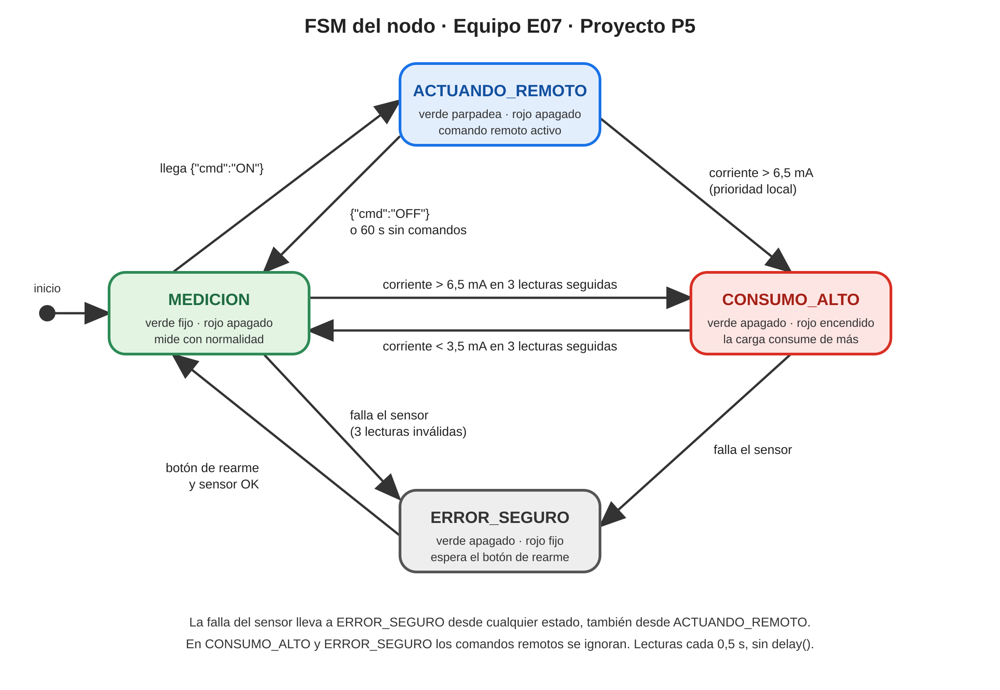

# P5 · Monitor del Consumo Eléctrico

Proyecto del equipo **E07** para Fundamentos de IoT (Universidad Autónoma de Chile, 2026-2).

Un nodo ESP32 con un sensor INA219 mide la corriente de una carga (motores DC) alimentada por una power bank de 5 V. Avisa en el lugar con dos LED y publica los datos por MQTT para verlos en Grafana y Node-RED.

**Integrantes:** Benjamín Hernández · Ariel Lagos · Patricio Fabio · Rodrigo Soto

## Qué hay en cada carpeta

| Carpeta | Contenido |
|---|---|
| `firmware/sketch_dos_leds_cmd/` | **Código vigente del nodo.** Es el que se sube al ESP32. |
| `firmware/promedio_corriente/` | Sketch auxiliar para promediar la corriente y compararla con el multímetro. |
| `grafana/` | Consultas Flux del dashboard (último valor, promedio de 5 min y consulta propia). |
| `node-red/` | Flujo de Node-RED con el panel y los botones ON/OFF. |
| `docs/diagramas/` | Diagrama de la FSM y diagramas de conexión en protoboard. |
| `docs/entregas/` | Project Charter, informes y ficha de alimentación de la GT1. |
| `historial/` | Versiones anteriores del código, ordenadas por fecha. No se usan. |

## Hardware

| Componente | Conexión |
|---|---|
| INA219 (I2C, 0x40) | SDA → GPIO 21, SCL → GPIO 22, VCC → 3V3, GND → GND |
| OLED SSD1306 (I2C, 0x3C) | SDA → GPIO 21, SCL → GPIO 22 |
| LED verde (midiendo) | GPIO 16, con resistencia |
| LED rojo (alerta) | GPIO 4, con resistencia |
| Botón de rearme | GPIO 5 a GND (pull-up) |
| Motores DC | + a VIN− del INA219, − a GND. VIN+ va al + de la power bank |

La power bank alimenta el ESP32 directamente; el INA219 mide solo la corriente de los motores.

## Cómo funciona (FSM)

| Estado | LED verde | LED rojo | Se entra cuando |
|---|---|---|---|
| `MEDICION` | fijo | apagado | Estado inicial y normal |
| `CONSUMO_ALTO` | apagado | encendido | Corriente sobre 100 mA en 3 lecturas seguidas. Vuelve bajo 60 mA |
| `ACTUANDO_REMOTO` | parpadea | apagado | Llega `{"cmd":"ON"}`. Vuelve con `{"cmd":"OFF"}` o a los 60 s |
| `ERROR_SEGURO` | apagado | fijo | 3 lecturas inválidas del sensor. Se sale con el botón de rearme |

El nodo lee cada 0,5 s y no usa `delay()` en el lazo: todo se temporiza con `millis()`.

## MQTT

| Tópico | Contenido |
|---|---|
| `curso/E07/P5/esp32` | JSON cada 30 s y en cada cambio de estado: `voltaje` (V), `corriente` (mA), `potencia` (W), `sensor_ok`, `estado`, `rssi_dbm` |
| `curso/E07/P5/esp32/estado` | `online`, el nombre del estado de alerta, u `offline` (testamento) |
| `curso/E07/P5/esp32/cmd` | Comandos `{"cmd":"ON"}` y `{"cmd":"OFF"}` |

Telegraf guarda los datos en InfluxDB (bucket `mediciones`) y Grafana los consulta con los archivos de `grafana/`.

## Cómo cargar el código

1. Instalar en Arduino IDE el soporte para ESP32 y las bibliotecas: Adafruit INA219, Adafruit SSD1306, Adafruit GFX, PubSubClient y ArduinoJson (7.x).
2. Abrir `firmware/sketch_dos_leds_cmd/sketch_dos_leds_cmd.ino`.
3. Copiar `config.example.h` como `config.h` en esa misma carpeta y completar la red WiFi y el usuario y la clave MQTT.
4. Subir a la placa (ESP32 Dev Module).

**`config.h` no se sube al repositorio** (está en `.gitignore`). Las credenciales son confidenciales.

## Calibración

- **Voltaje:** corregido por offset a 5 V contra multímetro (`CAL_M`, `CAL_B`).
- **Corriente:** ajustada con un solo punto contra multímetro (`CAL_I = 0,663`). Falta una calibración con varias cargas conocidas.
